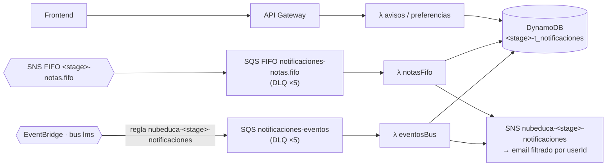

# nubeduca-ms-notificaciones

Microservicio de **avisos** de Nubeduca (tarea **ENG-01**). Consume eventos de los demás microservicios, guarda un aviso en la bandeja de cada usuario y le manda un **email** si lo tiene activo en sus preferencias.

- Solo **consume** eventos; no publica ninguno (ver `nubeduca-contratos/eventos/catalogo.yaml`).
- API según `nubeduca-contratos/apis/ms-notificaciones.openapi.yaml`.
- Responsable: Dev 6.

## Arquitectura



| Evento (`detail-type`) | Llega por | Qué hace |
|---|---|---|
| `lms.users.user.provisioned.v1` | bus | Crea las preferencias por defecto (sin pisar las existentes) |
| `lms.courses.enrollment.created.v1` | bus | Agrega al usuario a la lista del curso |
| `lms.courses.enrollment.dropped.v1` | bus | Lo quita de la lista del curso |
| `lms.courses.course.published.v1` | bus | Guarda el nombre del curso y avisa a los alumnos (`COURSE_PUBLISHED`) |
| `lms.content.module.published.v1` | bus | Avisa a los alumnos (`MODULE`) |
| `lms.courses.announcement.published.v1` | bus | Avisa a los alumnos (`ANNOUNCEMENT`) |
| `lms.assessment.assignment.published.v1` | bus | Avisa a los alumnos (`ASSIGNMENT`) |
| `lms.assessment.submission.submitted.v1` | bus | Constancia al alumno (`SUBMISSION_RECEIPT`) |
| `lms.grading.grade.posted.v1` | **solo cola FIFO** | Avisa al alumno su nota (`GRADE`), en orden por curso |

### Reglas de consumo (ARQ-01)

- **Idempotencia:** `INBOX#<eventId>` se escribe con `attribute_not_exists` en la misma `TransactWriteItems` que el cambio. Si ya existía, el evento se descarta.
- **Orden:** `AGG#<aggregateType>#<aggregateId>` guarda la última `aggregateVersion`. Un evento con versión igual o menor es viejo y se descarta.
- **Lector tolerante:** se ignoran los campos desconocidos; no se valida contra el esquema.
- **Sin correos duplicados:** el id del aviso sale de `(eventId, userId)` y se escribe con condición. Si el Lambda se cae a la mitad, el reintento completa lo que faltó sin reenviar correos.
- **Fallos parciales:** el Lambda devuelve `batchItemFailures`. Solo se reintenta el mensaje que falló, y después de 5 intentos va a la DLQ.

### Email

Los eventos no traen correos (payload mínimo), así que el email sale por el topic SNS `nubeduca-<stage>-notificaciones` con los atributos `tenantId`, `userId` y `type`. Cada correo se suscribe con una **política de filtro por `userId`**:

```bash
./scripts/suscribir_email.sh alumno.demo@gmail.com <userId> dev   # AWS pide confirmar la suscripción
```

Estado del aviso según la preferencia y el envío:

| Situación | `status` |
|---|---|
| La preferencia de ese tipo está desactivada (no se envía email) | `SKIPPED_BY_PREFERENCE` |
| Se publicó en SNS | `SENT` |
| Falló la publicación | `FAILED` |

## Tabla `${stage}-t_notificaciones`

Una sola tabla, con la misma forma que la plantilla de LOC-01: PK `tenant_id` (HASH) + `sk` (RANGE), `PAY_PER_REQUEST` y TTL en `ttl`. **El tenant va siempre en la clave de partición**, así que una consulta nunca cruza instituciones.

| `sk` | Entidad |
|---|---|
| `USER#<userId>#PREFS` | Preferencias de email |
| `USER#<userId>#NTF#<createdAt>#<notificationId>` | Aviso de la bandeja (ordenado por fecha) |
| `COURSE#<courseId>#INFO` | Nombre del curso (sale de `course.published`) |
| `COURSE#<courseId>#MEMBER#<userId>` | Matriculado en el curso |
| `AGG#<aggregateType>#<aggregateId>` | Última versión procesada de un agregado |
| `INBOX#<eventId>` | Evento ya procesado (se borra a los 7 días por TTL) |

### Estructura JSON de cada ítem

**Preferencias**
```json
{
  "tenant_id": "utec",
  "sk": "USER#a18577e2-e005-4a49-a29e-755dbf08f5b6#PREFS",
  "entidad": "PREFERENCIAS",
  "userId": "a18577e2-e005-4a49-a29e-755dbf08f5b6",
  "preferences": {
    "email": {
      "coursePublished": true,
      "announcements": false,
      "modules": true,
      "assignments": true,
      "submissionReceipts": true,
      "grades": true
    }
  },
  "updatedAt": "2026-11-10T15:00:00Z"
}
```

**Aviso**
```json
{
  "tenant_id": "utec",
  "sk": "USER#a18577e2-e005-4a49-a29e-755dbf08f5b6#NTF#2026-11-15T15:25:00Z#ntf_01JCMK0PDR4F6WQ2Z8M3N5B7TA",
  "entidad": "AVISO",
  "notificationId": "ntf_01JCMK0PDR4F6WQ2Z8M3N5B7TA",
  "userId": "a18577e2-e005-4a49-a29e-755dbf08f5b6",
  "type": "GRADE",
  "title": "Nota publicada en Cloud Computing",
  "courseId": "crs_01JCQRZHQT9F4WY2JYPDV546K7",
  "status": "SENT",
  "createdAt": "2026-11-15T15:25:00Z",
  "eventId": "01JCMK0PDR72NVMBVR2W0Z2J4Q"
}
```
`type`: `COURSE_PUBLISHED` · `ANNOUNCEMENT` · `MODULE` · `ASSIGNMENT` · `SUBMISSION_RECEIPT` · `GRADE`.
`status`: `SENT` · `FAILED` · `SKIPPED_BY_PREFERENCE`.

**Curso**
```json
{ "tenant_id": "utec", "sk": "COURSE#crs_01JCQRZHQT9F4WY2JYPDV546K7#INFO", "entidad": "CURSO",
  "courseId": "crs_01JCQRZHQT9F4WY2JYPDV546K7", "title": "Cloud Computing" }
```

**Matriculado**
```json
{ "tenant_id": "utec", "sk": "COURSE#crs_01JCQRZHQT9F4WY2JYPDV546K7#MEMBER#a18577e2-e005-4a49-a29e-755dbf08f5b6",
  "entidad": "MATRICULADO", "courseId": "crs_01JCQRZHQT9F4WY2JYPDV546K7",
  "userId": "a18577e2-e005-4a49-a29e-755dbf08f5b6", "role": "STUDENT", "enrollmentId": "enr_01JCQRZHQT9F4WY2JYPDV546K7" }
```

**Versión de agregado** y **inbox**
```json
{ "tenant_id": "utec", "sk": "AGG#enrollment#enr_01JCQRZHQT9F4WY2JYPDV546K7", "entidad": "AGREGADO", "version": 2 }
{ "tenant_id": "utec", "sk": "INBOX#01JCMK0PDR72NVMBVR2W0Z2J4Q", "entidad": "INBOX",
  "detailType": "lms.grading.grade.posted.v1", "procesadoEn": "2026-11-15T15:25:01Z", "ttl": 1763825101 }
```

## API

| Método | Ruta | Roles | Respuesta |
|---|---|---|---|
| GET | `/health` | pública | `{"status":"ok","service":"ms-notificaciones","version":"1.0.0"}` |
| GET | `/notifications/me?limit&nextToken` | STUDENT, TEACHER, ADMIN | `NotificationPage`, el más reciente primero |
| GET | `/preferences/me` | STUDENT, TEACHER, ADMIN | `Preferences` (todo `true` si nunca las cambió) |
| PUT | `/preferences/me` | STUDENT, TEACHER, ADMIN | `Preferences` guardadas |

Los errores tienen la forma del contrato: `{"code": "NO_AUTENTICADO", "message": "...", "requestId": "..."}`.

**Tenant y usuario salen del token, nunca del body.** `AUTH_MODE` define de dónde:

| `AUTH_MODE` | De dónde salen |
|---|---|
| `cognito` | Claims del authorizer de API Gateway (AUTH-01): `sub`, `custom:tenant_id`, `custom:role` |
| `mock` (por defecto hasta AUTH-01) | `Authorization: Bearer mock.<tenant>.<ROL>.<userId>`, el mismo token que usa el frontend en modo demo |

Colección de Postman: `postman/nubeduca-ms-notificaciones.postman_collection.json`.

## Desplegar

```bash
# 1. Solo en tu cuenta de pruebas: crea el bus lms y el tópico dev-notas.fifo
./scripts/crear_recursos_dev.sh dev

# 2. Pon tu org de Serverless en serverless.yml (org: ...) y despliega
sls deploy --stage dev
#   con Cognito:            sls deploy --param="authMode=cognito"
#   otra URL del frontend:  sls deploy --param="frontendUrl=https://..."

# 3. Suscribe tu correo para recibir los avisos de un usuario
./scripts/suscribir_email.sh tu@correo.com <userId> dev
```

En la cuenta del despliegue final (REL-01), el bus `lms` lo crea PLT-04 y el tópico `<stage>-notas.fifo` lo crea ms-calificaciones. No se corre el paso 1.

## Datos de prueba (30.000 registros)

```bash
pip install -r requirements.txt
python poblar_datos.py --stage dev                     # AWS
python poblar_datos.py --endpoint-url http://localhost:4566 --tabla local-t_notificaciones   # LocalStack
```

Carga 10.000 ítems por tenant (`utec`, `upc`, `pucp`): 1.000 preferencias y 9.000 avisos.
- Los ids son deterministas, así que correrlo dos veces no duplica nada.
- No escribe ítems `INBOX` ni `EVENTO#`, así que no dispara eventos ni correos.

## Probar

```bash
python -m venv .venv && .venv/bin/pip install -r requirements-dev.txt
.venv/bin/python -m pytest -q
```

Las pruebas usan `moto` (no necesitan AWS) y cubren:
- cada reacción;
- preferencias que bloquean el email;
- idempotencia (evento duplicado y reintento después de una caída);
- eventos viejos;
- la cola FIFO de notas;
- lotes con mensajes rotos;
- la API: paginación, aislamiento por tenant y usuario, y los modos de auth.

**Con LocalStack** (`nubeduca-infra/localstack`, que crea la tabla, la regla y las colas de este servicio):

```bash
export AWS_ENDPOINT_URL=http://localhost:4566 AWS_ACCESS_KEY_ID=test AWS_SECRET_ACCESS_KEY=test AWS_DEFAULT_REGION=us-east-1
./scripts/publicar_evento.sh ../nubeduca-contratos/eventos/ejemplos/lms.courses.course.published.v1.json
```

## Estructura

```
├── serverless.yml
├── api/                 # salud, avisos, preferencias (API Gateway)
├── consumidores/        # eventos_bus (regla del bus), notas_fifo (SNS FIFO) y reacciones
├── lib/                 # auth, http, eventos (inbox/orden), avisos, envío por SNS, tabla, logs
├── poblar_datos.py      # 30.000 registros
├── scripts/             # recursos de dev, suscribir email, publicar un evento
├── postman/
└── tests/
```
